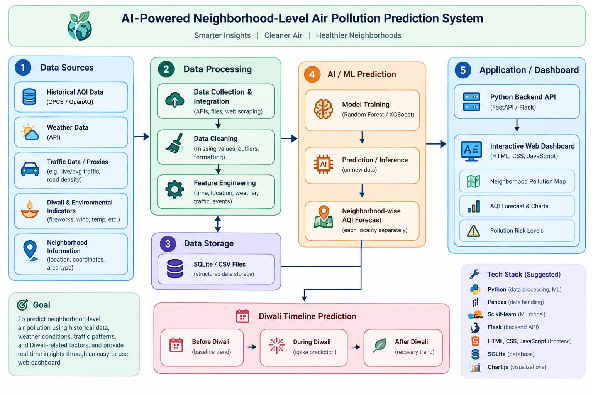

# air-quality-prediction
# AI-Powered Neighborhood-Level Air Pollution Prediction System

## Problem Statement
Developing an AI platform to predict neighborhood-level air pollution before, during, and after Diwali using historical AQI, weather, and traffic data.

## System Architecture

## Tech Stack (Planned)
- **Frontend:** Streamlit / React
- **Backend:** Python (FastAPI / Flask)
- **ML/AI Models:** Scikit-Learn / XGBoost / Pandas
- **Data Sources:** OpenAQ, Central Pollution Control Board (CPCB), OpenWeatherMap API

## Team & Setup
- Environment initialized with Python 3.x
- Skeleton repository created
