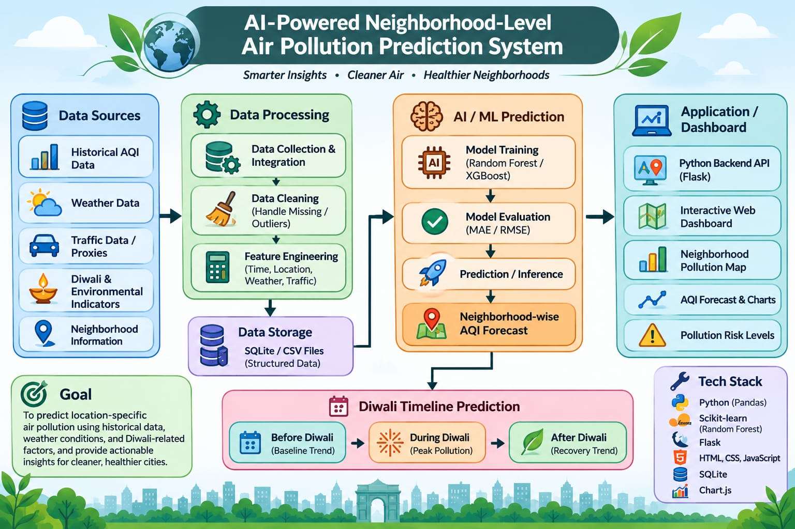

# Air Quality Prediction

Predicting neighborhood-level air pollution trends in Delhi-NCR across the Diwali period.

## Overview
Air quality drops severely around Diwali due to weather shifts, firecracker emissions, and traffic congestion. This project builds a hyper-local AQI prediction platform to analyze and forecast pollution levels before, during, and after Diwali to help residents and city planners prepare.

## Architecture

## Tech Stack
* **Framework / App:** Next.js (React Framework, Tailwind CSS)
* **Backend:** Next.js API Routes (Node.js)
* **Database:** PostgreSQL (Prisma ORM)
* **Data Visualization:** Recharts / Chart.js
* **External APIs:** OpenAQ, Central Pollution Control Board (CPCB), OpenWeatherMap API

## Current Progress (Round 1)
- [x] Initialized Next.js project structure & environment
- [x] Formulated problem statement & system architecture
- [ ] PostgreSQL schema setup (In Progress)
- [ ] Next.js API route implementation (/api/predict)
- [ ] Interactive Dashboard UI layout
